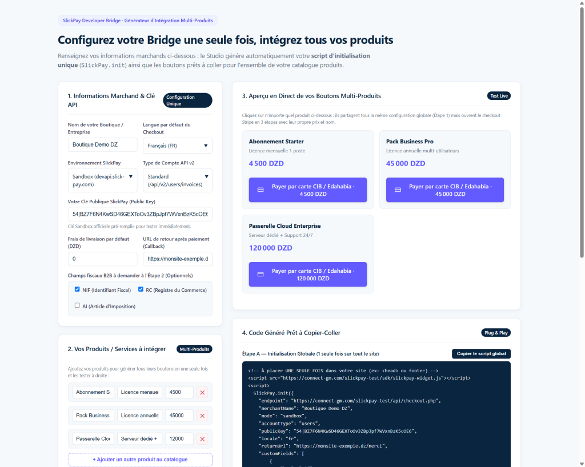
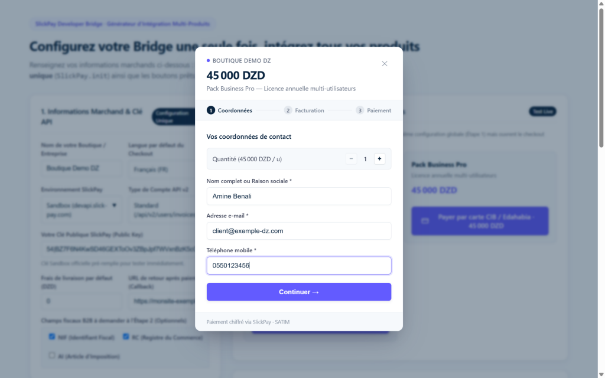
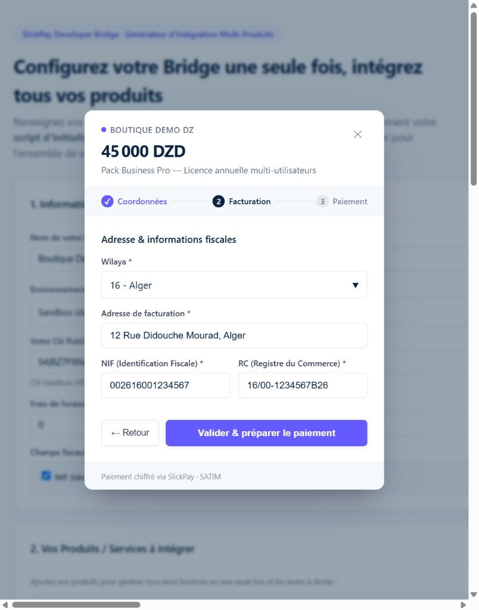
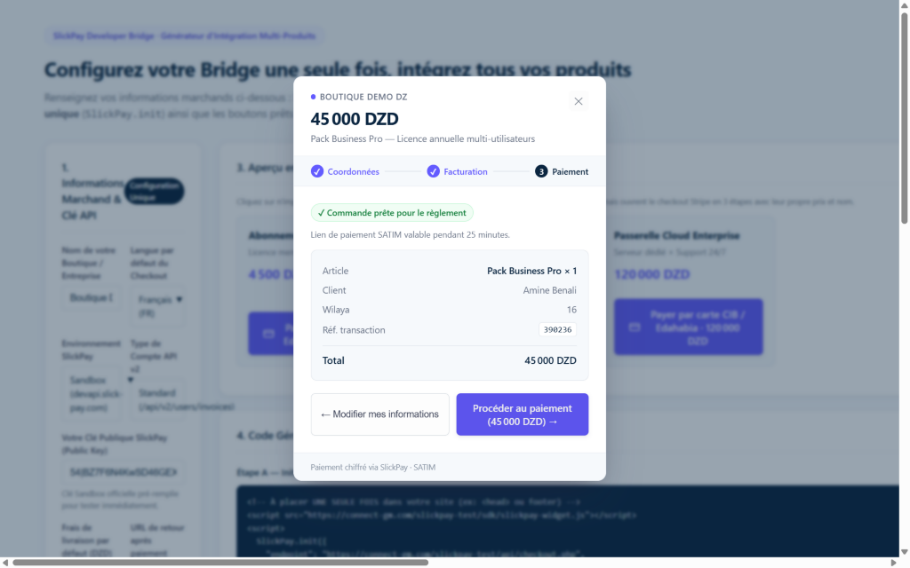

# SlickPay Bridge Studio

Passerelle web et studio générateur d'intégration multi-produits pour SlickPay (CIB / Edahabia / SATIM). Ce projet permet à tout développeur d'intégrer le paiement électronique algérien sur un site web ou une application SaaS en configurant sa boutique une seule fois (`SlickPay.init`), puis en déclenchant un parcours de paiement en 3 étapes inspiré de Stripe Checkout.

- Démo et générateur en ligne : [https://connect-gm.com/slickpay-test/](https://connect-gm.com/slickpay-test/)

---

## Aperçu du Studio et du parcours en 3 étapes

### 1. Interface du générateur multi-produits (Bridge Studio)

Le développeur renseigne les paramètres de sa boutique à gauche (nom de l'entreprise, langue par défaut, environnement `mock` / `sandbox` / `production`, route API v2, clé publique SlickPay, frais de livraison, URL de retour et champs fiscaux B2B optionnels), puis ajoute la liste de ses produits. Le studio affiche immédiatement l'aperçu fonctionnel à droite et génère les extraits de code prêts à être copiés.



### 2. Parcours client — Étape 1 : Coordonnées de contact

Lorsqu'un client clique sur un bouton de paiement, une modale isolée en Shadow DOM (compatible avec les politiques `Content-Security-Policy` strictes) s'ouvre sur la première étape : sélection de la quantité, nom complet ou raison sociale, adresse e-mail et numéro de téléphone mobile.



### 3. Parcours client — Étape 2 : Facturation et informations fiscales

La deuxième étape recueille la wilaya (liste complète des 58 wilayas d'Algérie, de `01 - Adrar` à `58 - El Meniaa`), l'adresse de facturation, ainsi que les champs fiscaux B2B activés par le marchand (`NIF`, `RC`, `AI`).



### 4. Parcours client — Étape 3 : Récapitulatif et redirection SATIM

Après validation de l'étape 2, la passerelle backend crée la facture auprès de l'API SlickPay (`/api/v2/users/invoices` ou `/api/v2/merchants/invoices`) et affiche le récapitulatif final avec la référence de transaction et le bouton de redirection vers le portail bancaire SATIM (`cib.satim.dz` / `satim.slick-pay.com`).



---

## Guide d'intégration pour les développeurs

L'intégration repose sur un principe simple : **une seule initialisation globale pour tout le site**, suivie d'autant de boutons produits que nécessaire.

### Étape A — Initialisation globale (une seule fois par site)

Placez ce bloc unique dans l'en-tête (`<head>`) ou en bas de page (`<footer>`) de votre site web :

```html
<script src="https://votre-domaine.dz/sdk/slickpay-widget.js"></script>
<script>
  SlickPay.init({
    endpoint: "https://votre-domaine.dz/api/checkout.php",
    merchantName: "Boutique Demo DZ",
    mode: "sandbox",          // "mock" | "sandbox" | "production"
    accountType: "users",     // "users" (/api/v2/users/invoices) | "merchants" (/api/v2/merchants/invoices)
    publicKey: "54|BZ7F6N4KwSD46GEXToOv3ZBpJpf7WVxnBzK5cOE6",
    locale: "fr",             // "fr" | "ar" (RTL automatique) | "en"
    deliveryFee: 0,
    returnUrl: "https://monsite-exemple.dz/merci",
    customFields: [
      { key: "nif", label: "NIF (Identification Fiscale)", required: true },
      { key: "rc", label: "RC (Registre du Commerce)", required: true }
    ]
  });
</script>
```

### Étape B — Ajout des produits (3 méthodes au choix)

Une fois `SlickPay.init(...)` déclaré, tous vos boutons héritent automatiquement de votre configuration marchand. Vous pouvez intégrer vos produits selon l'une des trois méthodes suivantes :

#### Méthode 1 : Balise Web Component `<slickpay-button>`

Utilisez la balise dédiée sur vos fiches produits en précisant uniquement le nom, la description et le montant en DZD :

```html
<slickpay-button
  product-name="Abonnement Starter"
  product-description="Licence mensuelle 1 poste"
  amount="4500"
></slickpay-button>

<slickpay-button
  product-name="Pack Business Pro"
  product-description="Licence annuelle multi-utilisateurs"
  amount="45000"
></slickpay-button>
```

#### Méthode 2 : Attributs `data-slickpay` sur vos propres boutons HTML/CSS

Si vous souhaitez conserver exactement le design CSS des boutons existants de votre thème (WordPress, Bootstrap, Tailwind, etc.), ajoutez simplement l'attribut `data-slickpay` accompagné des attributs `data-product-name` et `data-amount` :

```html
<button
  class="btn-custom-theme"
  data-slickpay
  data-product-name="Abonnement Starter"
  data-product-description="Licence mensuelle 1 poste"
  data-amount="4500"
>
  Acheter Abonnement Starter (4 500 DZD)
</button>
```

#### Méthode 3 : Appel JavaScript dynamique (`SlickPay.openCheckout`)

Pour un panier e-commerce multi-articles ou une application React / Vue / Next.js dans laquelle les coordonnées de l'utilisateur connecté sont déjà connues :

```javascript
SlickPay.openCheckout({
  productName: "Commande #1042",
  productDescription: "Panier 3 articles",
  amount: 25000,
  quantity: 1,
  prefill: {
    fullName: "Amine Benali",
    email: "client@exemple-dz.com",
    phone: "0550123456",
    wilaya: "16",
    address: "12 Rue Didouche Mourad, Alger",
    customFields: {
      nif: "002616001234567",
      rc: "16/00-1234567B26"
    }
  },
  onSuccess: function (session) {
    console.log("Facture créée :", session.invoiceId, session.paymentUrl);
  }
});
```

---

## Écoute des événements côté Frontend

Le SDK émet des événements DOM standards sur `window` permettant à votre application d'enregistrer la commande dès que la facture SlickPay est générée :

```javascript
window.addEventListener("slickpay:session-created", function (event) {
  const session = event.detail;
  console.log("ID Facture SlickPay :", session.invoiceId);
  console.log("URL de paiement SATIM :", session.paymentUrl);
  console.log("Montant total (DZD) :", session.totals.totalChargeDzd);
});

window.addEventListener("slickpay:session-error", function (event) {
  console.error("Erreur de création de session :", event.detail.error);
});
```

---

## Architecture Backend et compatibilité API SlickPay v2

Le dépôt fournit deux implémentations backend équivalentes pour relayer les appels vers SlickPay en évitant les problèmes de CORS et en normalisant les données :

1. **Passerelle PHP (`public/api/checkout.php`)** :
   - Prête à être déposée sur n'importe quel hébergement mutualisé, serveur cPanel, Apache ou Nginx (PHP 7.4+ avec `ext-curl`).
   - Normalise automatiquement les noms composés d'un seul mot (renseigne `firstname`, `lastname` et `name` pour éviter les erreurs `HTTP 422` sur `/api/v2/users/invoices` et `/api/v2/merchants/invoices`).
   - Nettoie le format du numéro de téléphone et détecte l'utilisation accidentelle d'une clé de test Sandbox en mode Production.

2. **Passerelle et SDK Node.js (`server/slickpay-sdk.mjs` et `server/index.mjs`)** :
   - Serveur HTTP Node.js autonome (zéro dépendance externe, utilise `fetch` natif).
   - Expose les routes `POST /api/slickpay/checkout`, `POST /api/slickpay/commission`, `GET /api/slickpay/status/:id`, `POST /api/slickpay/webhook` et `GET /api/slickpay/wilayas`.
   - Exporte également les classes `Invoice` et `MerchantInvoice` compatibles avec la signature du package `@slick-pay-algeria/slickpay-npm`, en corrigeant la route de calcul de commission (`POST /api/v2/users/invoices/commission`).

---

## Installation et exécution en local

Prérequis : Node.js 18 ou supérieur.

```bash
git clone https://github.com/MGhemri/SlickPay-Bridge-Studio.git
cd SlickPay-Bridge-Studio

# Exécuter la suite de tests automatisés
npm test

# Démarrer le serveur local et le Bridge Studio sur le port 3400
npm start
```

Ouvrez ensuite `http://localhost:3400` dans votre navigateur.

---

## Structure du dépôt

```text
SlickPay-Bridge-Studio/
├── docs/
│   └── screenshots/
│       ├── 01-bridge-studio-overview.png
│       ├── 02-checkout-step1-contact.png
│       ├── 03-checkout-step2-billing.png
│       └── 04-checkout-step3-payment.png
├── public/
│   ├── api/
│   │   └── checkout.php          # Passerelle Backend PHP / cURL (Sandbox, Production, Mock)
│   ├── sdk/
│   │   ├── slickpay-widget.css   # Feuille de style isolée (design Stripe Checkout, CSP-safe)
│   │   └── slickpay-widget.js    # SDK Frontend (SlickPay.init, <slickpay-button>, data-slickpay)
│   ├── index.html                # Interface du générateur multi-produits (Bridge Studio)
│   ├── playground.css            # Styles du Bridge Studio
│   └── playground.js             # Logique du générateur de code et de l'aperçu multi-produits
├── server/
│   ├── index.mjs                 # Serveur HTTP Node.js
│   └── slickpay-sdk.mjs          # Coeur du SDK Node.js + classes Invoice / MerchantInvoice
├── test/
│   └── gateway.test.mjs          # Tests unitaires et d'intégration
├── package.json
└── README.md
```
