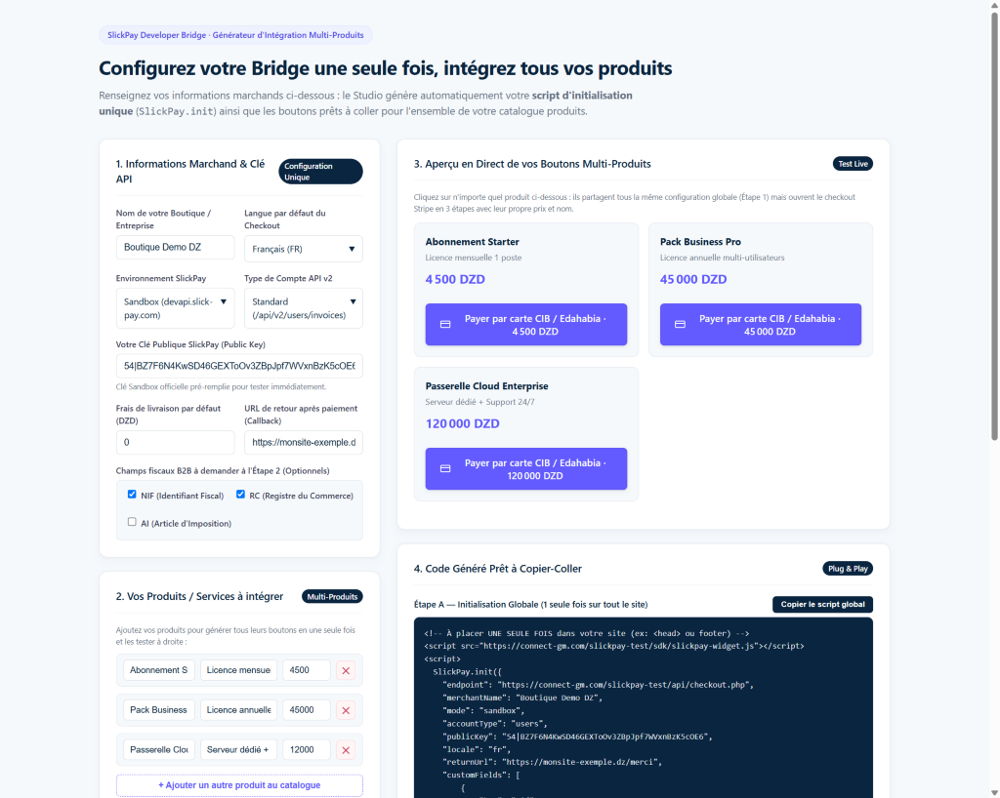

# Guide d'utilisation simplifié (Pour débutants et développeurs)

Ce document explique pas à pas comment intégrer le paiement par carte bancaire algérienne (**CIB / Edahabia via SlickPay & SATIM**) sur n'importe quel site web, même sans connaissances avancées en programmation.

---

## Comprendre les 3 modes d'utilisation

Beaucoup d'utilisateurs se demandent : *« Dois-je installer Node.js sur mon ordinateur pour que le bouton fonctionne sur mon site web ? »*

La réponse est **NON**. Il existe 3 façons d'utiliser **SlickPay Bridge Studio** selon votre profil :

| Mode | Pour qui ? | Ce qu'il faut installer | Comment ça fonctionne ? |
| :--- | :--- | :--- | :--- |
| **Mode 1 — Service Hébergé (CDN)** | Débutants, commerçants, intégrateurs WordPress / HTML / Shopify | **Rien (0 installation)** | Vous ouvrez le générateur en ligne, vous remplissez vos informations et vous copiez-collez le code généré directement dans votre site. |
| **Mode 2 — Auto-Hébergé (PHP / cPanel)** | Développeurs ou agences qui veulent héberger le Bridge sur leur propre domaine | **3 fichiers** à glisser dans votre cPanel / FTP | Vous copiez les dossiers `sdk/` et `api/checkout.php` sur votre propre hébergement web pour être 100 % autonome. |
| **Mode 3 — Local / Node.js (`localhost:3400`)** | Développeurs avancés / Contributeurs | Node.js 18+ (`git clone` + `npm start`) | Sert uniquement à tester ou modifier le code source du Bridge sur votre ordinateur personnel. |

---

## Mode 1 — Intégration directe sans rien installer (Recommandé pour les non-initiés)

Si vous avez déjà un site web en ligne (WordPress, WooCommerce, PrestaShop, site vitrine HTML, Webflow, React...) et que vous voulez ajouter le paiement CIB / Edahabia en 2 minutes :

*(Note : Actuellement hébergé sur le serveur de démonstration `connect-gm.com/slickpay-test/`, ce service a vocation à pouvoir être hébergé directement sur l'infrastructure officielle de SlickPay s'ils souhaitent l'adopter nativement).*

### Étape 1 : Générer votre code personnalisé

1. Ouvrez le générateur en ligne dans votre navigateur : **[https://connect-gm.com/slickpay-test/](https://connect-gm.com/slickpay-test/)**
2. Dans l'encadré **1. Informations Marchand & Clé API** (à gauche) :
   - Entrez le **Nom de votre Boutique / Entreprise**.
   - Choisissez la **Langue** du formulaire de paiement (`Français`, `Arabe`, ou `Anglais`).
   - Choisissez l'**Environnement** :
     - `Sandbox` pour faire des tests avec la clé de test.
     - `Production` lorsque vous avez récupéré votre vraie **Clé Publique (Public Key)** dans votre tableau de bord SlickPay.
   - Indiquez vos **Frais de livraison** par défaut (ou laissez `0`) et l'**URL de retour** (la page « Merci » de votre site).
   - Cochez ou décochez les champs fiscaux B2B (`NIF`, `RC`, `AI`) selon que vous vendez à des entreprises ou à des particuliers.
3. Dans l'encadré **2. Vos Produits / Services à intégrer** :
   - Ajoutez tous les produits de votre site (Nom, Description, Prix en DZD).



### Étape 2 : Copier-coller le code dans votre site

Dans l'encadré **4. Code Généré Prêt à Copier-Coller** (en bas à droite du générateur) :

1. Cliquez sur **« Copier le script global »** (Étape A) et collez ce code **une seule fois** dans l'en-tête (`<head>`) ou le pied de page (`<footer>`) de votre site web.
2. Cliquez sur **« Copier les boutons »** (Étape B) et collez chaque bouton à l'endroit où vous voulez vendre votre produit sur votre page :
   - Si vous voulez utiliser le bouton prêt à l'emploi style Stripe, choisissez l'onglet **`Balise <slickpay-button>`**.
   - Si vous avez déjà vos propres boutons sur votre site et que vous ne voulez pas changer leur apparence, choisissez l'onglet **`Sur vos propres boutons (data-slickpay)`**.

**C'est terminé !** Dès qu'un visiteur clique sur l'un de vos produits, la fenêtre de paiement en 3 étapes s'ouvre sur votre site.

---

## Mode 2 — Auto-hébergement sur votre propre serveur web (cPanel / PHP)

Si vous préférez ne pas dépendre d'un serveur externe et héberger la passerelle sur votre propre nom de domaine (par exemple `https://maboutique.dz/slickpay/`) :

1. Téléchargez ce dépôt GitHub (bouton **Code > Download ZIP** sur GitHub).
2. Ouvrez le dossier `public/` du fichier ZIP. Vous n'avez besoin que de ces **3 fichiers** :
   - `public/sdk/slickpay-widget.js`
   - `public/sdk/slickpay-widget.css`
   - `public/api/checkout.php`
3. Connectez-vous à votre hébergement web (via le **Gestionnaire de fichiers cPanel** ou FileZilla FTP) et créez un dossier `slickpay` dans `public_html/` :
   - Placez `slickpay-widget.js` et `slickpay-widget.css` dans `public_html/slickpay/sdk/`
   - Placez `checkout.php` dans `public_html/slickpay/api/`
4. Dans le script global `SlickPay.init(...)` de votre site, remplacez simplement les URLs par votre propre domaine :

```html
<script src="https://maboutique.dz/slickpay/sdk/slickpay-widget.js"></script>
<script>
  SlickPay.init({
    endpoint: "https://maboutique.dz/slickpay/api/checkout.php",
    merchantName: "Ma Boutique DZ",
    mode: "production",
    accountType: "users",
    publicKey: "VOTRE_CLE_PUBLIQUE_SLICKPAY",
    locale: "fr"
  });
</script>
```

---

## Mode 3 — Exécution en local sur votre ordinateur (`localhost:3400`)

**Attention :** Les commandes `git clone`, `npm test` et `npm start` décrites dans le fichier principal s'exécutent sur votre ordinateur personnel (`http://localhost:3400`).
- Tant que le serveur tourne sur `localhost:3400`, **vous seul** pouvez y accéder depuis votre ordinateur.
- Ce mode est destiné aux développeurs qui souhaitent tester le générateur hors-ligne, vérifier les tests unitaires, ou héberger la version Node.js (`server/index.mjs`) sur un serveur VPS Cloud (Ubuntu, Docker, Railway, Render, etc.).

---

## Foire Aux Questions (Dépannage rapide)

### 1. Pourquoi ai-je une erreur `403` quand je passe en mode `Production` ?
La clé pré-remplie dans le générateur (`54|BZ7F6N4KwSD46GEXToOv3ZBpJpf7WVxnBzK5cOE6`) est une **clé publique de test Sandbox**. Elle ne fonctionne que lorsque l'environnement est réglé sur **Sandbox (`devapi.slick-pay.com`)**. Pour passer en mode **Production (`prodapi.slick-pay.com`)**, vous devez remplacer cette clé par votre clé publique de production disponible dans votre compte marchand SlickPay.

### 2. Quelle est la différence entre `Standard (/api/v2/users/invoices)` et `Marchand (/api/v2/merchants/invoices)` ?
- **`Standard (/api/v2/users/invoices)`** fonctionne immédiatement avec toutes les clés publiques SlickPay standards (Sandbox et Production). C'est l'option recommandée par défaut.
- **`Marchand (/api/v2/merchants/invoices)`** correspond à la classe `MerchantInvoice` des SDKs SlickPay et exige que votre compte SlickPay ait un contrat TPV bancaire formellement rattaché côté SlickPay.

---

## Licence et Contact Commercial

L'utilisation de ce Bridge est gratuite uniquement pour le développeur sur ses propres projets. Toute utilisation pour le compte de clients tiers ou commercialisation nécessite une licence commerciale :

- **Auteur** : GHEMRI M
- **Téléphone** : 0549 77 73 66
- **E-mail** : [contact@connect-gm.com](mailto:contact@connect-gm.com)
- **Site web** : [https://connect-gm.com](https://connect-gm.com)
